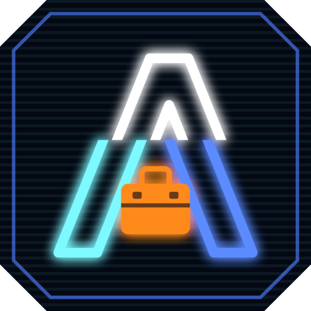

<p align="center">
  
</p>

<h1 align="center">Aria Vault</h1>

<p align="center">
  Ton coffre de mots de passe Vaultwarden, en HTTPS, dans un seul exe Windows.<br>
  Il démarre en silence dans la zone de notification et sert les applis Bitwarden<br>
  de ton téléphone, de ton navigateur et de ton PC. Rien à installer, aucun port à ouvrir.
</p>

<p align="center">
  <a href="../../releases/latest"><b>Télécharger la dernière version</b></a> · v0.4 · Windows 10/11 x64 · licence MIT
</p>

## Ce qu'il fait

| Fonction | Ce que ça fait |
| --- | --- |
| **Coffre Vaultwarden** | Serveur compatible Bitwarden, compilé depuis le source officiel et embarqué dans l'exe. Il n'écoute que sur `127.0.0.1` : invisible du réseau |
| **HTTPS automatique** | Vrai certificat Let's Encrypt obtenu et renouvelé seul, par validation DNS chez DuckDNS. Aucun port à ouvrir sur la box, et l'appli Bitwarden Android l'accepte |
| **Zone de notification** | Démarre en silence à l'ouverture de session. L'icône s'allume quand le coffre est en ligne, le clic droit ouvre le menu |
| **Sauvegardes** | En un clic ou chaque jour, les 10 dernières sont gardées. Une restauration ne supprime jamais rien |
| **Réglages exportables** | Domaine et jeton dans un fichier `.ariavault` chiffré par ta phrase de passe, pour réinstaller ailleurs sans rien ressaisir |
| **Mises à jour** | Lance la nouvelle version : l'ancienne s'arrête proprement et lui laisse la place |

## Avant de commencer

- **Un sous-domaine DuckDNS**, gratuit en deux minutes sur [duckdns.org](https://www.duckdns.org). Pas besoin d'acheter un nom de domaine : DuckDNS est le fournisseur que gère Aria aujourd'hui.
- **Une adresse IP fixe pour le PC.** Relève-la avec `ipconfig` (ligne « Adresse IPv4 »), puis réserve-la pour ce PC dans l'interface de ta box, section DHCP (« bail statique » ou « adresse réservée »). Si elle change, ton téléphone ne trouve plus le coffre.
- Sur duckdns.org, fais pointer ton sous-domaine vers cette **adresse privée** (`192.168.x.x`) et note le **jeton** affiché en haut de la page.
- Hors de chez toi, ton téléphone passe par ton **VPN** : rien n'est exposé sur Internet.

## Installation

1. Télécharge `Aria-Vault-<version>.zip` dans les [Releases](../../releases) et décompresse-le dans un dossier qui ne bougera pas (pas Téléchargements).
2. Lance `Aria-Vault.exe`. L'exe n'est pas signé : si Windows SmartScreen affiche « Windows a protégé votre ordinateur », clique sur « Informations complémentaires » puis « Exécuter quand même ».
3. Quand le pare-feu Windows le demande, autorise Aria sur les **réseaux privés** uniquement.

Aria tourne sans droits administrateur : seule l'autorisation du pare-feu peut demander une confirmation.

## Premiers pas

1. **HTTPS** : saisis ton sous-domaine DuckDNS et son jeton, puis enregistre. Le premier certificat arrive en quelques minutes au plus, le temps que DuckDNS publie la preuve.
2. **Réglages** : active « Autoriser les inscriptions », crée ton compte depuis le navigateur (bouton « Ouvrir le coffre »), puis désactive-les aussitôt.
3. **Téléphone** : dans l'appli Bitwarden, à l'écran de connexion, choisis un serveur auto-hébergé et saisis `https://ton-sous-domaine.duckdns.org`.
4. **Réglages** : active « Lancer à l'ouverture de session ».
5. **Sauvegardes** : choisis un dossier, idéalement dans OneDrive ou sur un autre disque, puis exporte tes réglages avec une phrase de passe.

> **Le mot de passe maître est irrécupérable.** Aucune procédure de réinitialisation n'existe : s'il est perdu, le coffre est définitivement illisible.

### Tu viens d'une installation Vaultwarden + Caddy ?

Page **Sauvegardes** → « Importer un ancien coffre… », puis choisis ton ancien dossier `data` (par exemple `C:\Vaultwarden\data`). Pense à désactiver tes anciennes tâches planifiées : Caddy occuperait le port 443.

## Au quotidien

- **Fermer la fenêtre** la renvoie dans la zone de notification : le coffre continue de servir ton téléphone.
- **Clic droit sur l'icône** : ouvrir le coffre, sauvegarder, démarrer ou arrêter le serveur, quitter.
- **Mettre à jour** : lance la nouvelle version. L'ancienne termine ce qu'elle fait (sauvegarde en cours, arrêt du serveur), puis lui laisse la place. Une version plus ancienne ne prend jamais la place d'une plus récente.

## Sauvegardes

Tout le coffre tient dans un petit zip : base SQLite, clés du serveur, pièces jointes et Sends. Tes mots de passe y restent chiffrés par ton mot de passe maître.

- Aucune sauvegarde tant que tu n'as pas choisi le dossier : Aria ne décide pas à ta place où vont tes données.
- Le serveur se met en pause quelques secondes le temps de la copie, puis repart. Le zip est relu et vérifié avant d'être gardé.
- **Restaurer** met d'abord le coffre actuel de côté, dans `data.avant-restauration-<date>` : rien n'est jamais supprimé.
- Les **réglages d'Aria** (domaine, e-mail, jeton DuckDNS) s'exportent à part, dans un fichier `.ariavault` entièrement chiffré (scrypt + AES-256-GCM). Sans la phrase de passe, rien n'y est lisible.

## Où sont tes données

Tout est dans `%LOCALAPPDATA%\AriaVault`, propre à ton compte Windows :

| Dossier | Contenu |
| --- | --- |
| `data\` | **Le coffre** : base, clés du serveur, pièces jointes |
| `certificats\` | Certificat Let's Encrypt et compte ACME |
| `config.json` | Réglages d'Aria. Le jeton DuckDNS y est chiffré avec DPAPI, lié à ton compte Windows |
| `aria.log` | Journal (aussi visible dans la page Journal) |
| `moteur\` | Vaultwarden et l'interface web, réextraits et vérifiés à chaque démarrage |

Les versions 0.3 et précédentes (sous le nom Aria Vaultwarden) utilisaient `%LOCALAPPDATA%\AriaVaultwarden` : ce dossier est renommé automatiquement au premier lancement.

## Sécurité

- **Vaultwarden n'est jamais joignable directement** : il n'écoute que sur `127.0.0.1:8000`, tout passe par le HTTPS d'Aria.
- **Aucun port ouvert sur la box** : le certificat est obtenu par validation DNS, et le domaine pointe vers une adresse privée.
- **Le panneau `/admin` de Vaultwarden est désactivé** : Aria ne définit aucun jeton d'administration, les réglages passent par Aria.
- **La vraie IP des clients est transmise à Vaultwarden**, et celle envoyée par un client est ignorée : son limiteur de tentatives de connexion fonctionne normalement.
- **Rattaché à Aria** : si Aria se ferme ou plante, Windows arrête Vaultwarden avec elle.

### Limites à connaître

- **Le coffre ne tourne que pendant ta session Windows.** Session fermée ou PC en veille : ton téléphone garde sa copie hors ligne et se resynchronise au retour.
- **DuckDNS uniquement** pour l'instant.
- **L'exe n'est pas signé** : vérifie l'empreinte SHA-256 et l'attestation publiées avec chaque release.
- Si tu importes un ancien coffre qui contient un `config.json` écrit par le panneau `/admin`, ses réglages priment sur ceux d'Aria. Le journal te le signale.
- Projet personnel, sans audit de sécurité indépendant.

## Provenance des composants

| Composant | Source | Vérification |
| --- | --- | --- |
| Vaultwarden | Compilé par GitHub Actions depuis [dani-garcia/vaultwarden](https://github.com/dani-garcia/vaultwarden), au tag de la release officielle, **sans aucune modification** | Tag et commit exacts dans les notes de chaque release et dans `BUILDINFO.txt` |
| Interface web | Release officielle de [dani-garcia/bw_web_builds](https://github.com/dani-garcia/bw_web_builds), appariée à la version de Vaultwarden | SHA-256 comparé au `sha256sums.txt` officiel, la compilation échoue en cas d'écart |
| Aria-Vault.exe et le zip | Compilés par le workflow de ce dépôt | Attestation de provenance Sigstore ([`actions/attest-build-provenance`](https://github.com/actions/attest-build-provenance)) |

Pour vérifier que le fichier téléchargé sort bien de ce dépôt (avec le [CLI GitHub](https://cli.github.com), `winget install GitHub.cli`) :

```powershell
gh attestation verify .\Aria-Vault.exe --owner ZedjeK
```

## Compiler soi-même

Le plus simple, sans rien installer : **fork** de ce dépôt, onglet **Actions** → *Compiler Aria Vault* → **Run workflow**. Compte 20 à 40 minutes la première fois. L'exe se télécharge en bas de la page du run, section **Artifacts**.

En local, avec [Go](https://go.dev/dl/) 1.26 ou plus et [Node.js](https://nodejs.org/) LTS, à partir d'un Vaultwarden déjà compilé (un dossier contenant `vaultwarden.exe` et `web-vault\`) :

```powershell
powershell -ExecutionPolicy Bypass -File .\build.ps1 -Vaultwarden D:\vaultwarden
```

## Structure

```text
src/
├── main.go                 # appli Wails : fenêtre, icône, instance unique, relève
├── vaultservice.go         # méthodes appelées par l'interface
├── sauvegardes.go          # sauvegardes, restauration, réglages exportables
├── internal/
│   ├── vaultwarden/        # Vaultwarden embarqué : extraction vérifiée, processus enfant
│   ├── tlsproxy/           # HTTPS : certificat Let's Encrypt (CertMagic, DNS-01) et relais
│   ├── moteur/             # démarrage, arrêt et état du coffre
│   ├── sauvegarde/         # zip du coffre, rotation, restauration, import
│   ├── config/             # réglages, jeton chiffré DPAPI, export .ariavault
│   ├── releve/             # une nouvelle version prend la place de l'ancienne
│   ├── demarrage/          # lancement à l'ouverture de session
│   ├── paths/              # emplacements, migration depuis Aria Vaultwarden
│   ├── journal/            # journal de l'interface et aria.log
│   └── ports/              # port occupé : par quel programme
├── frontend/src/           # interface Svelte (polices embarquées)
└── build/                  # logo, icônes de l'exe et de la zone de notification
```

## Licence

Code d'Aria Vault sous licence [MIT](LICENSE). Les composants embarqués gardent leur propre licence : Vaultwarden sous AGPL-3.0, l'interface web sous GPL-3.0. Leurs textes complets sont dans le zip de chaque release, la liste complète dans [LICENCES-TIERS.txt](LICENCES-TIERS.txt).

Aria Vault n'est ni affilié ni approuvé par le projet Vaultwarden, ni par Bitwarden, Inc.
