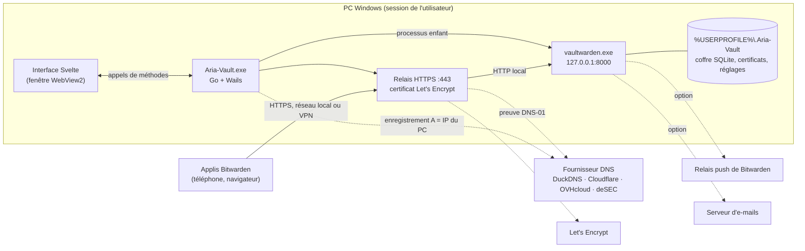
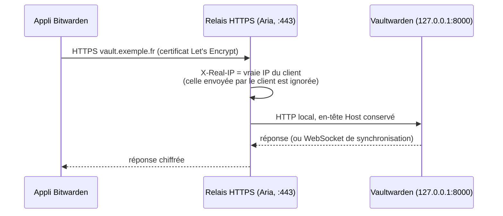
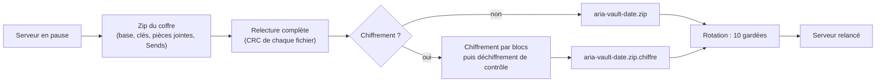
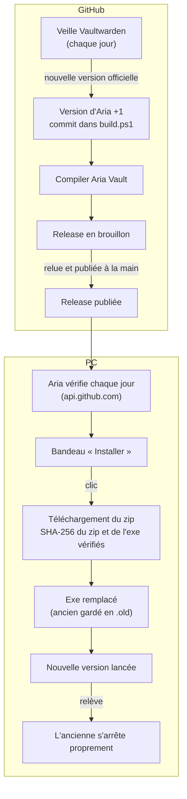
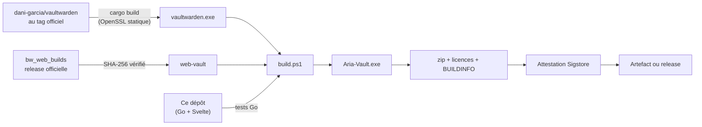

# Architecture d'Aria Vault

Ce guide explique comment Aria Vault fonctionne, de bout en bout. C'est la porte d'entrée pour lire le code : chaque partie renvoie aux fichiers concernés, et chaque fichier commence par un commentaire qui décrit son rôle.

## En une image

Tout tient dans un seul exe. Vaultwarden, compilé depuis son source officiel, et son interface web officielle y sont embarqués, extraits au démarrage puis lancés comme processus enfant. Aria s'occupe de tout le reste : HTTPS, adresse IP, sauvegardes, mises à jour et interface.

## Le code en un coup d'œil

| Où | Quoi |
| --- | --- |
| `src/main.go` | Lancement : relève, migrations, appli Wails, fenêtre, icône de la zone de notification |
| `src/vaultservice.go`, `sauvegardes.go`, `services.go` | Le service appelé par l'interface : une méthode Go par action |
| `src/fenetre.go` | Taille et position de la fenêtre retenues |
| `src/internal/moteur` | Démarre, arrête et surveille le couple Vaultwarden + HTTPS |
| `src/internal/vaultwarden` | Vaultwarden embarqué : extraction vérifiée, variables d'environnement, processus enfant |
| `src/internal/tlsproxy` | Certificat (CertMagic, DNS-01) et relais HTTPS vers Vaultwarden |
| `src/internal/dnsprov` | Les quatre fournisseurs DNS (libdns) et leurs tutos |
| `src/internal/ipdyn` | Le domaine suit l'adresse IP locale du PC |
| `src/internal/sauvegarde` | Zip du coffre, chiffrement, rotation, restauration, reprise après coupure |
| `src/internal/chiffre` | scrypt + AES-256-GCM, en un bloc ou en flux |
| `src/internal/config` | `config.json`, secrets chiffrés avec DPAPI, export `.ariavault` |
| `src/internal/maj` | Nouvelle version publiée ? Installation vérifiée en un clic |
| `src/internal/releve` | Une nouvelle version prend la place de l'ancienne |
| `src/internal/paths` | Emplacements des données et migrations |
| `src/internal/courriel`, `eveil`, `fenetre`, `demarrage`, `journal`, `ports` | E-mail de test, veille, fenêtre, démarrage avec la session, journal, port occupé |
| `src/frontend/src` | Interface Svelte 5 ; `lib/state.svelte.js` fait le lien avec le Go |
| `build.ps1`, `.github/workflows` | Compilation et publication |

## Le lancement, pas à pas

`main()` enchaîne les étapes dans un ordre qui compte :

1. **La relève** (`releve.Reprendre`). Si une version plus ancienne d'Aria tourne encore, elle reçoit l'ordre de s'arrêter, par un événement Windows nommé `Local\AriaVault-fermeture`. On lui laisse 20 secondes pour arrêter proprement son serveur, sinon son processus est terminé. Cette étape passe avant tout le reste, parce que l'ancienne version tient encore la base de données et le port 443. Une version plus ancienne ne prend jamais la place d'une plus récente.
2. **Les emplacements** (`paths.Migrer`, puis `paths.Deplacer`). Le cache reste dans `%LOCALAPPDATA%\AriaVault`. Les données (coffre, certificats, réglages, journal) vont dans `%USERPROFILE%\.Aria-Vault`. Elles sont déplacées depuis les emplacements des versions précédentes en passant par un dossier d'étape, renommé seulement à la fin : une coupure de courant en plein déplacement est reprise au lancement suivant.
3. **La réparation** (`sauvegarde.Reparer`). Si une restauration a été interrompue, elle est terminée, ou annulée en remettant l'ancien coffre en place.
4. **L'appli Wails.** Elle tourne en instance unique : relancer l'exe ne fait qu'afficher la fenêtre existante. Elle crée le service, la fenêtre (cachée tant qu'elle n'est pas placée) et l'icône de la zone de notification avec son menu.
5. **Au démarrage de l'appli.** La fenêtre est placée et affichée, sauf en mode silencieux. Les boucles de fond démarrent (sauvegarde quotidienne, IP publiée, mises à jour), puis le coffre démarre s'il est configuré.

En mode silencieux (`--silencieux`, celui de l'entrée « lancer à l'ouverture de session »), la fenêtre reste cachée et seule l'icône apparaît. Fermer la fenêtre ne fait que la cacher : le coffre continue de servir le téléphone.

## Le chemin d'une requête

- **Vaultwarden n'écoute que sur `127.0.0.1`** : il est invisible du réseau, et tout passe par le relais d'Aria (`tlsproxy`).
- **La vraie IP du client** est transmise à Vaultwarden : son limiteur de tentatives de connexion fonctionne normalement.
- **Le domaine pointe vers l'adresse privée du PC** (`192.168.x.x`). Le coffre n'est donc joignable que depuis le réseau local, ou par le VPN de l'utilisateur. Aucun port n'est ouvert sur la box.
- **Vaultwarden est rattaché à un « job » Windows** (`vaultwarden/child_windows.go`) : si Aria se ferme ou plante, Windows l'arrête avec elle.
- **Vaultwarden est configuré uniquement par variables d'environnement**, et seule une liste blanche de variables du système lui est transmise : une variable `ADMIN_TOKEN` ou `DATABASE_URL` traînant dans la session ne peut pas le reconfigurer. Le panneau `/admin` reste fermé.

## Le certificat : DNS-01

Let's Encrypt doit vérifier que le domaine nous appartient. Avec la méthode DNS-01, Aria publie un enregistrement TXT temporaire chez le fournisseur DNS, Let's Encrypt le lit, puis Aria l'efface. Aucune connexion entrante n'est nécessaire, ce qui permet de garder la box fermée.

CertMagic (le moteur de Caddy) gère l'obtention et le renouvellement automatique, 30 jours avant l'expiration. Le client DNS vient de `dnsprov.Nouveau`, qui fabrique le bon client [libdns](https://github.com/libdns) selon le fournisseur. Les messages de CertMagic arrivent dans le journal d'Aria (`journal.Core`).

## L'adresse IP publiée

Toutes les 10 minutes (`ipdyn.Veilleur`) :

1. Aria trouve l'adresse locale du PC : celle de la carte réseau qui mène à Internet. Un « faux » envoi UDP fait choisir la route, sans qu'aucun paquet ne parte.
2. Il lit l'adresse publiée pour le domaine. Pour Cloudflare, OVHcloud et deSEC, il passe par l'API du fournisseur. Pour DuckDNS, qui n'a pas d'API de lecture, il interroge des résolveurs publics, et non la box, qui peut filtrer les réponses en adresse privée.
3. Si les deux diffèrent, il met à jour l'enregistrement A. Seules les adresses de réseau local sont publiées, ce qui évite par exemple de publier l'adresse d'un VPN. Juste après une mise à jour, il ne republie pas la même adresse tant que les caches DNS n'ont pas suivi.

Réserver l'adresse du PC sur la box reste conseillé : la page HTTPS a un tuto pour chaque box.

## Les sauvegardes

- **Cohérence** : le serveur est mis en pause quelques secondes, le temps de copier la base SQLite et ses fichiers `-wal` et `-shm`.
- **Chiffrement** (`chiffre`) : la clé est dérivée de la phrase par scrypt (N = 2¹⁷). Le contenu est chiffré en blocs de 64 Kio avec AES-256-GCM, et le nonce de chaque bloc contient son numéro et un indicateur « dernier bloc ». Un bloc retiré, déplacé ou un fichier tronqué est donc détecté. Le zip en clair n'existe que le temps de la copie, à côté du coffre, jamais dans le dossier des sauvegardes (qui peut être dans OneDrive).
- **Restauration** : le coffre actuel est renommé en `data.avant-restauration-<date>`, puis la sauvegarde, extraite dans `data.restauration`, prend sa place. Rien n'est jamais supprimé, et `Reparer` termine le travail si une coupure survient entre deux renommages.

## Les secrets

| Secret | Où | Protection |
| --- | --- | --- |
| Identifiants DNS, clé push, mot de passe e-mail, phrase des sauvegardes | `config.json` | DPAPI : liés au compte Windows, illisibles depuis un autre compte ou un autre PC |
| Réglages exportés | fichier `.ariavault` | Entièrement chiffré par une phrase de passe (scrypt + AES-256-GCM, en-tête authentifié) |
| Mots de passe du coffre | base de Vaultwarden | Chiffrés par les applis Bitwarden avec le mot de passe maître : le serveur ne les voit jamais en clair |

Les secrets ne repartent jamais vers l'interface : un champ laissé vide garde la valeur enregistrée.

## Les mises à jour

- **Côté GitHub**, rien n'est publié automatiquement : la veille prépare un brouillon, et un humain le relit puis le publie.
- **Côté PC**, rien n'est téléchargé sans un clic. Les empreintes publiées dans les notes de la release et celle calculée par GitHub doivent concorder. En cas d'erreur, rien n'est modifié, et si la nouvelle version ne démarre pas, l'ancienne est remise en place.

## L'interface

L'interface est une page Svelte 5 affichée par WebView2, compilée par Vite et embarquée dans l'exe : aucun serveur web, aucune police téléchargée.

- **Appels** : `lib/state.svelte.js` appelle les méthodes exportées du `VaultService` par leur nom (`Call.ByName("main.VaultService.Start")`). Wails transporte les arguments et les réponses en JSON.
- **État** : le Go reste la source de vérité. L'interface relit l'état (`Status`) après chaque action et toutes les 2 secondes.
- **Événements** : le Go peut demander d'afficher une page (`page`, depuis le menu de l'icône) ou envoyer la progression d'un téléchargement (`maj-progression`).
- **Disposition** : les grilles passent de 1 à 3 colonnes grâce aux *container queries*. La barre latérale se replie en icônes, à la main ou d'office quand la fenêtre est étroite.

## La compilation

Tout se compile sur un runner Windows de GitHub, avec le dernier correctif de Go 1.26. `BUILDINFO.txt` dans le zip donne le commit d'Aria, la version et le commit de Vaultwarden, ainsi que les versions des outils. La signature de l'exe par SignPath Foundation est prête dans le workflow, mais reste inactive tant que le projet n'est pas accepté (voir [SIGNATURE.md](SIGNATURE.md)).

## Choix et compromis

- **Wails plutôt qu'Electron** : un exe Go d'environ 60 Mo (dont Vaultwarden), qui utilise le WebView2 déjà présent dans Windows.
- **Vaultwarden en processus enfant** plutôt que réécrit ou modifié : il est compilé sans aucune modification, ce qui permet de suivre ses versions officielles telles quelles.
- **DNS-01 et adresse privée** : un vrai certificat, accepté par l'appli Android, sans exposer le coffre sur Internet.
- **Session Windows** : Aria tourne avec les droits de l'utilisateur, jamais en administrateur, et non comme un service système. Le coffre ne tourne donc que pendant la session ; les applis Bitwarden gardent une copie hors ligne en attendant.
- **Pas de télémétrie** : les seules connexions sortantes sont listées dans [SIGNATURE.md](SIGNATURE.md#confidentialité).
